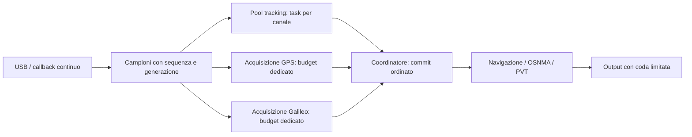

# NGene Classic — ottimizzazioni, profiling e distribuzione del carico

**Aggiornamento 29 ottobre:** la navigazione e' ora denominata PNT. Eigen,
confermato dall'utente dopo confronto con Armadillo, sostituisce la matematica
matriciale custom; aggiunti WLS, correzioni smoothing e supporto PRN EGNOS
121/123. EGNOS123 aggancia nel replay. Risultati e regressioni metriche sono
in [PNT_REVIEW.md](PNT_REVIEW.md): 11/11 test e 54/54 confronti sintetici.
Le considerazioni precedenti sull'assenza di dipendenze/necessita' di Eigen
descrivono il vecchio stato, superato dalla nuova indicazione dell'utente.

**Aggiornamento 28 ottobre:** implementate e verificate le correzioni dell'audit
pseudorange/PVT, inclusa la regressione DOP e la gestione misure Kalman.
Dettagli, limiti e risultati nella
[sezione finale dell'audit](PSEUDORANGE_PVT_AUDIT.md#5-correzioni-implementate-e-verifiche-finali):
10/10 CTest e 43/43 confronti sintetici. Restano le perdite RF, distinte dagli
scarti PVT e dalle epoche KF di sola previsione.

**Periodo:** 26-27 ottobre 2026. Build Windows operativa senza profiling
aggiuntivo, 9/9 test superati. Nessun pool DSP concorrente attivato.
Le sezioni 1-9 descrivono il primo intervento (23 fix SiGe e 29 HackRF su
registrazioni precedenti); le sezioni 10-13 aggiungono la diagnosi dei nuovi
file Linux, il profiling FFT e il confronto con l'acquisizione SiGe IF.

## 1. Risultato e significato delle misure

Il problema osservato non si riduce a un costo eccessivo del mixer HackRF.
L'acquisizione GNSS occupa gli slot del ricevitore anche durante i raffinamenti
lunghi; nel caso misto GPS/Galileo puo' ritardare la ricerca di altri GPS fino a
impedire il PVT durante la registrazione. La disponibilita' di tempo CPU medio
non garantisce che il lavoro venga assegnato nel modo utile al fix.

Con la stessa lista Galileo e gli stessi file RF, la pulizia Java/IFEN da sola
mantiene esattamente gli eventi GNSS precedenti. Introducendo una quota per
le ricerche Galileo, il replay misto passa da zero a 23 fix SiGe e 29 HackRF.
Il miglioramento dimostrato riguarda **disponibilita' del fix e scheduling**;
non e' una dimostrazione di maggiore accuratezza metrica o di uno speedup CPU.

La causa delle interruzioni USB live non e' stata riprodotta: la sonda non trova
il SiGe 16c0:072f. Il replay non esercita USB, firmware, driver o callback live.

## 2. Modifiche operative mantenute

### Catena essenziale senza Java e IFEN

Sono stati eliminati dal codice e dalla build:

- server TCP, protocollo e pacchetti della GUI Java, configurazione ricevuta
  dalla GUI e relativo ciclo di startup/stop;
- calcolo e invio di spettro, istogramma ed effemeridi destinati alla GUI;
- export dei messaggi di navigazione in formato IFEN e gestione dei relativi
  file, timestamp e split dei log;
- harness separato che riproduceva soltanto messaggi di navigazione IFEN e il
  suo template di configurazione;
- ricerca generatore di tutti i PRN Galileo e fallback implicito a tale ricerca.

Restano l'interfaccia ncurses predefinita e quella testuale (`-t`), i frontend
SiGe/HackRF, il replay RF, tracking, navigazione, PVT, RINEX/NMEA e i moduli di
autenticazione GNSS. L'opzione `--port` non esiste piu'. La configurazione e'
letta direttamente all'avvio, senza attendere un client esterno.

La ricerca automatica Galileo legge sempre
`otherData/Galileo_real_PRNs.txt`. La lista e' un dato mantenibile dall'utente,
non una verifica online dei satelliti attualmente operativi. Quando Galileo e'
abilitato, lista mancante, vuota o con PRN fuori dall'intervallo supportato
interrompe lo startup con un errore esplicito. Non parte una ricerca piu' ampia
senza avvertire l'operatore. Le configurazioni operative locali e i template
sono stati ripuliti dalle opzioni Java/IFEN rimosse.

### Quota di acquisizione tra costellazioni

`TChannelScheduler` mantiene un contatore delle ricerche Galileo attive.
Finche' il numero di canali GPS in tracking e' inferiore al numero configurato,
viene ammesso **un solo tentativo Galileo contemporaneo**. Un tentativo occupa
lo slot da assegnazione PRN fino a successo o fallimento, inclusi raffinamento
e conferma. Il contatore viene incrementato all'assegnazione e decrementato in
entrambi i percorsi di rilascio.

La ricerca Galileo rimane attiva. Quando non sono configurati canali GPS, il
limite aggiuntivo non si applica. Il limite totale storico di acquisizione,
variabile con il numero di canali tracciati, rimane in vigore. La quota non
equivale a una divisione del tempo CPU: e' una correzione minima dello scheduler
seriale, preparatoria a una distribuzione piu' completa del lavoro.

E' stata tolta la fissazione del main al processore logico 1; il sistema puo'
schedularlo liberamente. La gestione esistente del thread frontend resta
separata. Non si deduce una separazione fra core fisici dagli indici logici.

### Precisione e produzione

Questo intervento non cambia mixer, rappresentazione dei campioni, FFT,
correlatori, discriminatori, soglie di lock, carrier smoothing o algoritmi PVT.
Nessuna costante e' stata introdotta per spostare le coordinate verso una
posizione attesa. Le modalita' fast/precise sono un possibile intervento futuro.

Il profiling esteso e il runner sono conservati in `development/profiling/`,
esclusi dalla compilazione e installazione. Il main operativo conserva solo il
profiling storico, compilato fuori nella build normale. `build.cmd` imposta
esplicitamente `NGENE_RX_PROFILING=OFF`, anche dopo una build di misura.

## 3. Metodo di profiling

Ambiente: Windows x64, Intel Core i7-1355U, compilatore clang-cl del toolchain
Visual Studio e build nativa CMake/Ninja. L'assembly storico mantiene le opzioni
conservative gia' presenti; non e' stata applicata un'ottimizzazione globale
che potrebbe violarne il contratto sui registri.

Registrazioni locali:

| File | Dimensione | Durata nominale |
| --- | ---: | ---: |
| `recordings/native-ab.raw` | 794.615.808 byte | circa 48,55 s |
| `recordings/hackrf-l1-vga56-ci8.raw` | 1.145.831.424 byte | circa 70,01 s |

La configurazione mista usa 8 canali GPS, 8 Galileo e 1 EGNOS; il controllo GPS
usa 8/0/0, modificati soltanto nella copia della prova. In tutti i confronti del
27 ottobre la ricerca Galileo usa la medesima lista, anche nel vecchio binario.
Il vecchio binario trova l'opzione all-PRN assente e usa il proprio default
disabilitato: si confronta quindi la stessa politica della lista.

Ogni run copia binario, configurazione e dati in una cartella isolata
`build/profile-*/run-*`, poi salva stdout, stderr, exit code, hash del binario,
tempo wall e tempo CPU del processo. La strumentazione temporanea aggiunge:

- tempo di ingresso, comprendente lettura, attesa e conversione;
- lavoro dopo il riempimento del ring e tempo complessivo dei channel manager;
- tempi per stato e costellazione, massimo intervallo e avanzamento in campioni.

Il clock monotono misura tempo trascorso, incluse le deschedulazioni. Un massimo
di decine di millisecondi non prova un kernel altrettanto lungo in CPU. Il tempo
CPU del processo include startup e tutti i thread. I contatori di stato contano
anche chiamate che non avanzano il canale; il campo campioni permette di vedere
quanto lavoro temporale sia effettivamente avanzato. Non rappresenta il numero
di FFT o di bin. I sottostadi storici sono annidati: non vanno sommati agli
aggregati. Il profiling stesso aggiunge overhead.

## 4. Risultati controllati del 27 ottobre

Queste sono singole esecuzioni di confronto, non stime statistiche di speedup.

| Variante | File | Wall [s] | CPU processo [s] | Fix PVT | Perdite tracking riportate |
| --- | --- | ---: | ---: | ---: | ---: |
| Vecchio binario, lista limitata | SiGe | 10,26 | 9,17 | 0 | 0 |
| Pulizia Java/IFEN, senza quota | SiGe | 10,07 | 9,13 | 0 | 0 |
| Vecchio binario, lista limitata | HackRF | 17,66 | 16,55 | 0 | 0 |
| Pulizia Java/IFEN, senza quota | HackRF | 19,96 | 18,73 | 0 | 0 |
| Pulizia, controllo solo GPS | HackRF | 23,59 | 19,28 | 29 | 0 |
| Quota Galileo, misto, profiling esteso | HackRF | 21,39 | 20,34 | 29 | 0 |
| Quota Galileo, misto, profiling esteso | SiGe | 15,58 | 14,66 | 23 | 0 |
| **Produzione finale, profiling OFF, misto** | **HackRF** | **24,90** | **23,52** | **29** | **0** |
| **Produzione finale, profiling OFF, misto** | **SiGe** | **15,25** | **14,03** | **23** | **0** |

Il tempo piu' alto della run HackRF senza profiling rispetto a quella strumentata
evidenzia la variabilita' del sistema; non attribuire differenze fra singole run
al solo overhead dei contatori. Anche il lavoro cambia: ottenere piu' canali
in tracking e produrre PVT puo' aumentare il consumo CPU complessivo.

La produzione finale elabora entrambe le registrazioni piu' velocemente della
loro durata, ma questo margine medio non certifica la stabilita' live.

### Dove viene speso il tempo

Esempio HackRF misto dopo la sola pulizia, prima della quota:

| Stato | GPS [s] | Galileo [s] |
| --- | ---: | ---: |
| Ricerca grossolana | 0,517 | 8,150 |
| Raffinamento Doppler | 0,708 | 4,481 |
| Raffinamento codice | 0,089 | 0,569 |
| Tracking | 3,276 | nessun canale in quello stato |

Con la quota, sullo stesso file misto, la ricerca grossolana Galileo scende a
1,625 s e il raffinamento Doppler a 1,173 s; il tracking GPS sale a 6,691 s e
porta 29 fix. Nel controllo solo GPS il tracking pesa 12,039 s e produce ancora
29 fix: sono carichi satellitari diversi, non confronti di kernel equivalenti.

Il tempo per un millisecondo di timeline avanzata nel tracking GPS e' circa
9,47 us sul SiGe misto senza quota e 39,08 us sull'HackRF misto senza quota.
Con la quota HackRF e' circa 26,73 us. Queste differenze comprendono stato dei
loop, parser, logging, workload e scheduling: non isolano il costo della
precisione multibit. Per stabilirlo serve lo stesso input e lo stesso lavoro
attraverso due kernel controllati.

### Picchi e prime misure del 26 ottobre

Tre replay strumentati per frontend, con la precedente configurazione all-PRN,
hanno dato mediane CPU di 10,28 s SiGe e 18,72 s HackRF. Non vanno confrontate
direttamente con la quota finale: ordine PRN e workload sono differenti.
Su SiGe il massimo intervallo di elaborazione varia fra 8,0 e 66,6 ms nelle tre
run; sono picchi wall, non attribuzioni certe al DSP.

Nelle run con quota, i massimi di elaborazione escluso il riempimento sono
4,916 ms SiGe e 14,816 ms HackRF. Non basta questo confronto per sostenere una
riduzione ripetibile della latenza: carico e pianificazione OS variano.

## 5. Accuratezza del fix e verifiche di equivalenza

La sola pulizia mantiene **88 righe ordinate SiGe e 82 HackRF identiche** al
vecchio binario, rimossi timestamp host, percorsi di startup e il messaggio
relativo all'opzione IFEN eliminata. Queste configurazioni miste non producevano
PVT: il confronto verifica gli eventi registrati, non l'accuratezza dei fix.

Dopo la quota, la versione finale senza profiling mantiene **428 righe SiGe e
524 HackRF identiche** alla corrispondente versione strumentata, escluse le righe
di profiling e gli stessi metadati. Il confronto include epoche e coordinate
PVT stampate. Nessun CSV di profiling viene prodotto dalla build finale.

Il controllo HackRF solo GPS usa 5 satelliti nel primo fix; la prova mista con
quota ne usa 4. Le medie delle coordinate stampate sono:

| Configurazione HackRF | Latitudine [gradi] | Longitudine [gradi] | Altezza ellissoidica [m] |
| --- | ---: | ---: | ---: |
| Solo GPS, 29 fix | 44,24361876 | 7,39665100 | 947,929 |
| Mista con quota, 29 fix | 44,24358979 | 7,39668514 | 961,150 |

La differenza verticale di circa 13,22 m **non e' una misura di maggiore o minore
accuratezza**, perche' insieme di satelliti e storia delle osservazioni non sono
gli stessi e manca un riferimento d'antenna rilevato. E' comunque una differenza
da conservare come limite concreto: non si dichiara equivalenza delle osservabili
fra questi due workload. Le soglie non sono state allentate per ottenere i fix.

## 6. USB e ipotesi dell'analisi fornita

Il ricevitore ha gia' un thread USB; la parte DSP dei canali e' seriale.
Nel SiGe, quando il ring e' pieno il produttore attende. Continua a gestire gli
eventi, ma non puo' riciclare indefinitamente i trasferimenti completati senza
spazio. Il successivo timeout puo' riavviare lo stream e azzerare il ring USB.
La generazione del flusso risincronizza il decoder I/Q, ma non resetta tutta la
timeline del ring DSP, tracking e PVT. Questo resta un rischio concreto nel
codice, non una causa live confermata qui.

HackRF interrompe invece il ricevitore quando la sua coda va in overflow:
non continua indefinitamente dopo lo scarto di campioni. Con blocchi predefiniti:

| Buffer | Capacita' | Durata nominale a 16,3676 MB/s |
| --- | ---: | ---: |
| Trasferimenti SiGe, 128 blocchi | 1 MiB | 64,1 ms |
| Ring intermedio SiGe, 512 blocchi | 4 MiB | 256,3 ms |
| Coda applicativa HackRF | 1 MiB | 64,1 ms |

Le capacita' nominali non garantiscono assenza di perdite a monte. Aumentare una
coda assorbe burst, ma non rende sostenibile un consumer mediamente piu' lento.

La stima della soglia di conferma basata su carrier anziche' sui campioni
demodulati compare nel ramo storico non-wide; HackRF usa gia' un ramo distinto
`MeasureHackrfConfirmationNoise`. Quindi quel sospetto non va applicato
indistintamente a entrambi i frontend. Non e' stato corretto senza una verifica
statistica delle soglie. Anche lock checker e hard restart PVT restano invariati.
Il confronto con `CODE/Old NGene Code` e' stato fornito dall'utente e non ripetuto
in questo workspace.

## 7. Distribuzione del lavoro tra core: progetto successivo

La scelta proposta combina separazione per funzioni e task DSP per canale.

Punto di partenza da misurare: ingresso indipendente, pool tracking limitato,
due worker o due quote di lavoro per acquisizione GPS/Galileo, commit sul main.
Se una costellazione ha poco lavoro, la capacita' libera puo' essere usata
dall'altra. I numeri ottimali di worker non sono stati misurati qui: confrontare
1/2/4 worker e CPU, latenza, tempo al primo fix e continuita' live.

Due thread permanenti, uno per costellazione, garantiscono separazione delle
ricerche ma possono essere sbilanciati. Due tentativi GPS e due Galileo alternati
garantiscono una quota di opportunita', non del tempo CPU: il costo delle ricerche
non e' uguale. Serve interrompere il lavoro a passi limitati e conservare stato
ed epoca, senza aspettare il termine di un intero tentativo. La variante 2+2 e'
stata discussa ma non implementata o misurata, su indicazione di concludere prima
questo intervento.

Prerequisiti obbligatori:

| Dato o dipendenza | Intervento necessario |
| --- | --- |
| `ngeneXmmsBackup` globale nell'assembly | Backup privato per thread in tutti i moduli interessati o conversione a intrinsics con ABI completa |
| Carrier, mixer, subcarrier, codici e scratch FFT condivisi | Contesto DSP privato; copiare `TNGeneData` superficialmente non basta |
| Puntatori early/prompt/late del tracking | Eliminare l'aliasing verso `rx->codeArray` condiviso |
| Stato NCO e integrazioni | Un solo job in volo per canale, ordine temporale preservato |
| Scheduler PRN, non-coherent manager, warm start | Prenotazione e commit coerenti sul coordinatore |
| Parser, clock, OSNMA, PVT e buffer dei log | Separare elaborazione DSP e side effect condivisi |
| Ring e minimo offset fra canali | Rilasciare i campioni soltanto dopo tutti i lettori |

L'acquisizione deve possedere una finestra di campioni o un riferimento limitato
indipendente dall'avanzamento del tracking. Il candidato deve riportare
`streamGeneration`, primo campione, numero campioni e versione dello stato.
Un candidato vecchio richiede propagazione controllata o riconferma al tempo
corrente. Spostare soltanto la funzione su un thread lasciando il ring fermo
al minimo offset manterrebbe il blocco dell'intera catena.

Una discontinuita' deve invalidare job vecchi e lo stato temporale interessato.
Quando il gap non e' quantificabile, proseguire come se i campioni fossero
contigui non e' una gestione corretta della continuita' del PVT.

## 8. Fast e precise

La proposta fast riguarda la sinusoide **squadrata**, cioe' i segni di seno e
coseno, non il quadrato matematico della sinusoide. Puo' ridurre il costo del
mixer di ricerca. La scelta deve essere indipendente dal numero di worker.

Precise rimane il riferimento numerico. Fast, inizialmente solo acquisizione,
richiede confronto di sensibilita', falsi allarmi, segni Doppler, scaling delle
potenze e soglie di conferma. Non basta confrontare il tempo CPU: la squadratura
cambia il mixer e la sua risposta. Un eventuale tracking fast richiede anche
confronti delle osservabili e del PVT a parita' di satelliti. Nessuna di queste
approssimazioni e' attiva nella produzione finale.

## 9. Verifiche finali e materiali conservati

- Build Windows normale: **9/9 test superati** (frontend HackRF simulato, FFT,
  precisione I/Q, generatori DSP, SiGe, ring I/Q, errori e shutdown/restart USB,
  compatibilita' Windows).
- Replay finali: **23 fix SiGe / 29 HackRF**, exit code 0, nessuna perdita di
  tracking riportata e nessun file di profiling prodotto.
- Tre startup negativi: lista Galileo assente, vuota e PRN 51; tutti exit code 1.
- `--help` mostra testo/ncurses e non espone la porta Java.
- `git apply --check development/profiling/instrumentation.patch` superato.
- La verifica Linux di questo incremento e la prova live prolungata restano da
  eseguire; nessun risultato Windows/replay le sostituisce.

Il binario finale ha SHA-256
`7C54DB2A1E03C39D4227C53BE494453CB0283CE012AFD79E23D1F6DAA102480D`.
Il binario strumentato con quota ha SHA-256
`354DA93C42FF7F1528F72A40D08C6A9680CCD7C6472B37A2405708216293F83D`.

Le misure selezionate, profili di stato e hash sono conservati in
`development/profiling/results-20261027.json`. I log integrali locali sono nelle
cartelle `build/profile-*`; il file JSON ne conserva i riferimenti. Per ripetere
le misure usare [le istruzioni del laboratorio](development/profiling/README.md).
Per riprendere il lavoro in una sessione futura leggere [LOGBOOK.md](LOGBOOK.md).

## 10. Acquisizione del singolo satellite: confronto con SiGe IF

Su richiesta dell'utente, il riferimento e' il primo sorgente del repository,
commit `efcdb86` (Add NGene Classic source). Questo confronto e' stato eseguito;
non va confuso con quello, precedentemente fornito dall'utente, con una cartella
esterna `CODE/Old NGene Code`.

| Passo | Stato attuale rispetto al riferimento |
| --- | --- |
| Finestra campioni e rimozione portante | Stesso ruolo; aggiunti stride e mixer complesso per I/Q |
| Galileo: rimozione sottoportante BOC | Conservata; applicata alle due componenti nei nuovi percorsi |
| Compressione, FFT, prodotto col codice e trasformata inversa | Stessa struttura; backend FFT e dinamica numerica aggiornati |
| Bin fuori ricerca per la soglia coarse | Conservato (`FAKE_DOPPLER_INDEX`) |
| Somme non coerenti e ricerca massimo | Stessi contatori, ordine ritardo/Doppler e numero di somme; accumulo HackRF a 64 bit |
| Decisione coarse e propagazione fase codice | Stessa condizione massimo/soglia e correzione temporale |
| Raffinamento Doppler, poi codice | Stessi passi, contatori, massimi e transizioni |
| Conferma M-su-N | Stessi M/N, conteggio dei tentativi e successi, condizioni successo/fallimento |
| Ingresso nel tracking | Stessa transizione dopo conferma |

`acquisition/manageAcqConfiguration.c`, `nonCoherentSumsManager.c`,
`acqConfiguration.h` e `sampleConfigurationFiles/configuration/Acquisition.conf`
sono senza differenze dal riferimento. Il diff del manager non introduce nuove
transizioni nella catena del singolo tentativo. Non sono state aggiunte somme
coerenti fra periodi, nuove griglie, ricerca anticipata al primo picco o nuove
condizioni di conferma durante questa diagnosi.

**La realizzazione numerica HackRF non e' identica alla vecchia SiGe IF.**
Oltre al mixer complesso, usa compressione larga, FFT con tentativi di scaling
senza clipping, potenze/somme a 64 bit ed esponenti ripristinati. Queste differenze
gestiscono ampiezze ADC diverse; possono cambiare i valori rispetto a una catena
che satura o quantizza diversamente. Anche alcuni tipi condivisi sono stati
allargati: non si promette identita' binaria in caso di overflow storico.

La differenza piu' rilevante per le decisioni e' la **stima del rumore per la
soglia di conferma**. `MeasureHackrfConfirmationNoise` miscela e correla campioni
I/Q del ring. Il ramo non-wide mantiene il calcolo storico con i carrier; la
variabile demodulata non e' quella correlata per stimarne la varianza. La funzione
statistica `FindAcquisitionThreshold`, le probabilita' configurate e la regola
M-su-N restano le stesse, ma l'ingresso della stima HackRF e' diverso. Per questo
dire semplicemente "soglie invariate" sarebbe inesatto. Nessun ulteriore
intervento a questa stima e' stato fatto nel lavoro corrente; la sua equivalenza
statistica richiede una verifica dedicata di sensibilita' e falsi allarmi.

Vincolo dell'utente per il seguito: conservare la logica di acquisizione per
satellite della SiGe IF. FFT e mixer possono essere ottimizzati, dichiarando
separatamente ogni differenza numerica o di stima delle soglie. La precisazione
non riguarda lo scheduling fra costellazioni: la quota Galileo resta attiva,
nessun rollback e' stato eseguito.

## 11. Diagnosi dei file Linux del 27 ottobre

Configurazione confermata dall'utente: 8 GPS, 8 Galileo, 1 EGNOS, file identici
al repository. Host Linux: Xeon E3-1241 v3, 4 core / 8 CPU logiche, Gentoo
6.18.2. Gli output dichiarano libhackrf/tools 2024.02.1 e firmware n_260928,
API 1.13. Queste versioni sono un dato diagnostico, non una causa dimostrata.

### Interruzione nel log live

`ngene-live.log` contiene 137 fix validi fra Rx 34000 e 169544 ms, due warning
PLL Galileo recuperati, zero perdite finali di tracking e zero hard restart.
Termina con interruzione dello stream HackRF, uscita del thread frontend e
errore di stop RX `Input/Output Error (-1000)`. Il massimo della coda e'
295662 / 1048576 byte, **28.2%**: qui il log non dimostra un overflow della
coda applicativa. Il messaggio "cannot stop the Front End" viene dopo
l'interruzione e non identifica l'evento iniziale.

Servono evidenze Linux/USB contemporanee all'evento per attribuirlo al percorso
fisico, al driver, alla libreria o al dispositivo. Il replay non verifica queste
componenti. Non e' stato introdotto un riavvio trasparente che nasconda i gap.

### Cattura RF indipendente

`hackrf-l1-ci8.raw`: 1964112000 byte, 982056000 campioni complessi CI8,
8.1838 MS/s, 120 secondi. SHA-256 verificato:
`90C65DD542DE8EEE1B411FE60DF6CE24E12374B6C82261FF5FEEF213491168B1`.
La cattura inizia alle 09:15:52 UTC, dopo la sessione del log live. Il tool
termina con exit code 0 senza errore riportato; cio' non prova continuita' RF.
Impostazioni: centro 1575420000 Hz, filtro 5 MHz, LNA 32, VGA 56, amp 0,
antenna power 0.

La scansione di tutto il file trova il **65.151% di I e 65.292% di Q esattamente
a -128 o +127**, RMS centrato medio 111.445 conteggi. E' una forte saturazione
gia' nel dato registrato, prima del mixer software; non se ne recupera
l'informazione cambiando FFT. Nessuna variazione macroscopica dell'ampiezza
intorno al salto descritto sotto. La saturazione non dimostra, da sola, la causa
di tutte le perdite. Prova hardware successiva utile: ridurre VGA da 56 a 32,
conservare le altre condizioni e confrontare distribuzione ADC e continuita'.

Il replay misto produce 40 fix e 14 perdite di tracking concentrate attorno a
78.2-78.8 s. Il replay solo GPS produce 63 fix e 8 perdite nello stesso tratto.
Il fenomeno quindi si riproduce senza callback USB e senza Galileo.

Un controllo indipendente, con mixer e matched filter in double, senza mixer,
FFT, ring o tracking del ricevitore, individua un salto comune della fase codice
dei GPS 7 e 5 intorno a **77.073 s**. La variazione e' circa 350-353 campioni,
43 microsecondi modulo il periodo del codice; i picchi restano riconoscibili
prima e dopo. Il salto precede di circa un secondo le perdite dichiarate dal
tracking ed e' presente nel file RF stesso. Il CI8 non contiene timestamp o
contatori: non consente di ricavare il numero assoluto di campioni mancanti o
di assegnare la causa a firmware/USB/clock.

Il controllo del ring reale (`FillInputBuffer` e percorso di lettura produzione),
con confronto byte per byte contro un secondo lettore del file, preserva tutti
i 1964112000 byte sia con letture intere sia frammentate e attraversamenti del
ring. Esclude corruzioni riprodotte in questi due percorsi, non ogni possibile
problema di concorrenza o continuita' live.

### Accuratezza rispetto alla ground truth

Riferimento WGS84: latitudine 45.06538716666666 gradi, longitudine
7.659323472222223 gradi, quota ellissoidica 311.9349 m. SD fornite:
0.0003/0.0003/0.0016 m. L'offset fra riferimento rilevato e antenna non e'
stato fornito. Conversione geodetica -> ECEF -> ENU al riferimento, usando le
coordinate arrotondate dei log testuali; nessuna correzione delle soluzioni
verso la posizione nota.

| Sessione | Fix | Bias E/N/U [m] | RMS orizzontale [m] | P95 orizzontale [m] | RMS verticale [m] |
| --- | ---: | --- | ---: | ---: | ---: |
| Live Linux 8/8/1 | 137 | +1.965 / +2.455 / +7.185 | 7.612 | 14.688 | 8.496 |
| Replay RF 8/8/1 | 40 | +0.089 / -1.060 / -5.559 | 7.413 | 10.511 | 18.158 |
| Replay RF 8/0/0 | 63 | +1.581 / +1.315 / +5.948 | 2.778 | 4.344 | 7.346 |

Il misto parte con geometria debole (GDOP circa 26, 4 GPS e 2 Galileo).
Le due configurazioni non usano gli stessi satelliti o le stesse epoche valide;
il live e la cattura sono sessioni RF diverse. Questi risultati non isolano
un difetto Galileo ne' dimostrano un miglioramento di accuratezza del codice.
CSV, statistiche complete e grafici ENU/quota sono conservati negli
[artefatti diagnostici](development/profiling/diagnosi-20261027/).

## 12. Ottimizzazione FFT e costo CPU

Il percorso HackRF prova guadagni FFT successivi finche' ottiene una trasformata
senza clipping. Prima completava anche le trasformate gia' saturate, per poi
scartarle. `PerformFftTrial` termina appena un kernel segnala clipping. Il
chiamante scarta tutto l'output parziale e riparte dalla finestra originale.
La sequenza dei guadagni, la trasformata accettata, il ripristino degli esponenti
e le decisioni GNSS restano identici. SiGe continua a usare `PerformFft`.
`PerformFftChecked` mantiene il comportamento completo per chi necessita
dell'output e del conteggio integrale delle saturazioni.

La verifica FFT contro riferimento scalare copre 263056 casi, flag di clipping,
output esatto quando accettato, protezioni dei buffer e input immutabile.
Il replay misto completo prima/dopo produce gli stessi **928 eventi GNSS
ordinati**, inclusi 40 fix e 14 perdite, esclusi timestamp, percorsi di startup
e righe di profiling. SiGe sul file precedente conserva 23 fix e zero perdite.

Microbenchmark con la prima finestra RF, sei batch alternati nello stesso
processo: mediana per ricerca di scaling **173.945 -> 103.823 us (-40.3%)**,
stesso guadagno accettato (-9) e output esatto. Questo risultato riguarda
quel kernel e quella finestra, non l'intero ricevitore.

Profiling temporaneo sul replay completo, stessa sequenza di eventi:

| Voce | Prima [s] | Dopo [s] |
| --- | ---: | ---: |
| GPS coarse | 37.768 | 27.408 |
| Galileo coarse | 16.270 | 13.261 |
| EGNOS coarse | 27.264 | 18.563 |
| CPU processo (strumentato) | 111.609 | 87.109 |
| Wall (strumentato) | 117.924 | 99.156 |

**I tempi completi variano troppo per dichiarare uno speedup complessivo
affidabile.** Il baseline normale precedente aveva CPU 52.781 s / wall 54.714 s;
il replay normale successivo CPU 87.719 s / wall 95.704 s, pur con eventi GNSS
identici. Nel confronto alternato A/B/B/A su 15 s RF, CPU prima 8.313 e 15.469 s,
dopo 6.000 e 5.750 s: anche qui il baseline varia molto. Concorrenza e stato
dell'host influenzano la misura; i valori Windows non stimano direttamente il
carico sullo Xeon Linux. Non attribuire una riduzione stabile del 40% al processo.

Il 73% segnalato dall'utente e' letto in top/htop per il processo: nella
normalizzazione usuale equivale a circa 0.73 CPU logiche (circa 9.1% aggregato
su 8 CPU logiche). Modalita' di visualizzazione e denominatore vanno conservati
nel confronto col vecchio 13%. Anche a parita' di scala, front-end IF e I/Q,
ampiezze ADC, canali e fasi di acquisizione producono carichi diversi: il divario
non e' stato spiegato o risolto interamente da queste misure.

## 13. Produzione e ripetibilita' della diagnosi

La patch di profiling esteso e' stata rimossa dopo il confronto; build normale
con `NGENE_RX_PROFILING=OFF`, 9/9 verifiche. Il main e il supporto profiling
non hanno differenze rispetto a HEAD. Nessun nuovo logger per campione o worker
sperimentale resta in produzione. L'intervento operativo di questa diagnosi
riguarda solo FFT/contratto e le due chiamate del coarse HackRF.

Ultima ricompilazione normale e verifica 9/9, SHA-256 eseguibile:
`B961455BC429F22B61911CF1E2099DFBD84D51ED8F2979C7076CC67A1FADAD33`.
Gli hash dei binari effettivamente usati nei singoli replay restano in
`runs.json`; non sostituirli con quello di una ricompilazione successiva.

Gli strumenti indipendenti, i benchmark e gli analizzatori sono conservati in
`development/profiling/`, esclusi da CMake. I risultati derivati e i riferimenti
ai log completi locali sono in `diagnosi-20261027/runs.json`. I vecchi risultati
23/29 fix delle sezioni precedenti si riferiscono ad altri file RF.

Restano da risolvere: origine dell'interruzione USB live e del salto nel file;
prova RF con livelli non saturati; verifica statistica della stima soglie
HackRF; benchmark Linux ripetuto in condizioni confrontabili; separazione dei
dati prima di introdurre il pool multicore. Conservare nel frattempo la catena
di acquisizione per satellite chiarita nella sezione 10.

## 14. Controllo PVT / LMS, 28 ottobre 2026

Il metodo chiamato LMS nel progetto e' un least squares iterativo, non un
filtro adattativo a gradiente. Il controllo mirato ha individuato e corretto:

1. **Jacobiano:** le componenti della linea di vista erano divise per la
   pseudodistanza misurata, che contiene il bias di clock. Ora il denominatore
   e' la distanza geometrica usata nel modello della misura.
2. **Risoluzione numerica:** `inv(A'A) A'b` con LDU senza pivoting e nessuna
   segnalazione di singolarita' e' sostituito da QR Givens in double per i
   4/5 stati. Il nuovo solver non forma A'A, non alloca memoria ed espone il
   fallimento per rango numericamente insufficiente o dati non finiti. Stesso
   percorso per la velocita'. Armadillo non e' necessario per queste dimensioni.
3. **DOP:** geometria ricostruita alla posizione finale anche dopo LS;
   covarianza ricavata da R senza equazioni normali. HDOP/VDOP usano la
   proiezione locale orizzontale/verticale, anziche' X/Y/Z ECEF.
4. **Controlli:** lo scarto temporale Galileo usava `dt += abs(dt)`, che
   annullava gli errori negativi; ora usa il valore assoluto come GPS. Nel
   controllo dinamico veniva usata `sqrt(deltaPos)` invece di `sqrt(vel)` e
   mancava l'argomento del messaggio di errore. Corretti entrambi.
5. **Fallimento geometrico:** LS e DOP possono interrompere esplicitamente
   un'epoca non valida; il manager invalida il risultato e prepara la successiva,
   evitando un risultato numerico obsoleto o un tentativo continuo sulla stessa
   epoca. Le soglie configurate non sono state allentate.

Il solver usa 4 stati in singola costellazione e 5 nella soluzione GPS/Galileo,
con bias di clock distinti; la velocita' mantiene il modello storico a 4 stati.
Restano LS non pesato e massimo 7 iterazioni. Non sono stati introdotti pesi
C/N0, esclusione robusta degli outlier o nuovi modelli atmosferici. Questa e'
una verifica mirata, non una validazione completa di ogni correzione GNSS.

Test del nuovo solver su geometrie singole/miste, soluzioni note, ortogonalita'
dei residui, identita' della covarianza, condizionamento 1e9, rango insufficiente
e valori non finiti: superato. Totale build Windows **10/10**, profiling OFF.
Test nel target separato `ngene_check_pvt_solver`, nessun self-test nel main.

| Diagnosi, stesso RF | Fix prima/dopo | RMS H prima/dopo [m] | RMS U prima/dopo [m] | Perdite tracking prima/dopo |
| --- | --- | --- | --- | --- |
| GPS/Galileo/EGNOS 8/8/1 | 40 / 40 | 7.413 / 7.430 | 18.158 / 18.265 | 14 / 14 |
| GPS 8/0/0 | 63 / 63 | 2.778 / 2.778 | 7.346 / 7.346 | 8 / 8 |

I 14 eventi di perdita del replay misto coincidono anche per canale, campione
e motivo. Zero hard restart, zero fallimenti PVT gravi, 24 scarti per GDOP.
**Nessun miglioramento di accuratezza o stabilita' RF dimostrato su questo
record.** Le correzioni risolvono difetti del calcolo e dei controlli; non
spiegano da sole la dispersione metrica e non risolvono l'instabilita' segnalata.

La GUI mostra NAVIGATION quando `ch->pvtInfo.usedForPVT` e' vero. Il PVT resetta
questo flag a ogni tentativo e lo ripristina soltanto per le misure del fix
accettato. Quindi Navigation -> Tracking puo' rappresentare uno scarto PVT,
senza perdita di lock. Tracking -> Acquisition richiede TRACKING_LOST oppure
un hard restart dei canali: nel replay la causa riportata e' perdita PLL/CN0,
non hard restart. Nessuno di questi comportamenti e' stato mascherato cambiando
le etichette o le soglie. Il soft reset PVT azzera inoltre lo smoothing globale:
puo' allungare il recupero del fix, ma non comanda direttamente il lock RF.

Risultati completi in `development/profiling/diagnosi-20261027/pvt-qr-mixed/`
e `pvt-qr-gps/`; riferimenti e hash delle esecuzioni nei rispettivi `run.json`.
I tempi sono replay Windows concorrenti, non un benchmark di carico Linux.

## 15. Correzioni definitive dopo l'audit esteso, 28 ottobre

L'implementazione successiva corregge WN/TOW, GGTO, costanti GPS/Galileo,
health GPS, derivata orbitale al perigeo, clock rate e rotazione delle
osservabili. Aggiorna i minimi dopo le esclusioni e separa il DOP geometrico
dalla validita' di Kalman con poche misure. LS mantiene QR, controlla la
convergenza e usa la quota nel modello tropo condiviso; KF risolve l'innovazione
con Cholesky, conserva Joseph e controlla covarianza/varianze/incertezza.

Lo smoothing non viene piu' cancellato ad ogni epoca KF singola costellazione
o su un comune reset PVT soft. Le previsioni sono limitate a 100 m di sigma
spaziale formale, con DOP esplicitamente indisponibile e qualita' NMEA zero in
assenza di osservazioni. Dieci buffer inutilizzati dell'inversa sono eliminati.
Il main non contiene strumentazione sperimentale aggiuntiva.

Verifiche sul binario finale: **10/10 test della build e 43/43 confronti
sintetici**, replay misto LS/KF, GPS-only LS/KF e SiGe. Profiling OFF.
Misto: 40 soluzioni con misure in entrambi i metodi, piu' 12 previsioni KF.
GPS-only: 63 LS contro 64 con misure + 12 previsioni KF. Prima delle correzioni,
la configurazione KF GPS produceva 43 output, tutti LS, perche' ricadeva su LS.
SiGe conserva 23 soluzioni e zero perdite. I conteggi non sono un confronto di
sensibilita' RF o una misura di speedup CPU.

Nel confronto sulle 43 epoche GPS comuni vecchio/nuovo, stesso numero di GPS,
RMS orizzontale 4.291 -> 2.654 m e verticale 7.793 -> 7.460 m. Il confronto
comprende tutti i cambiamenti, non dimostra un vantaggio universale di KF.
Le 14 perdite RF miste e le 8 GPS-only rimangono. Nessun hard restart PVT nei
replay finali; USB/live non risolto da queste prove.

Il dettaglio e' nella [sezione 5 dell'audit](PSEUDORANGE_PVT_AUDIT.md#5-correzioni-implementate-e-verifiche-finali).
Risultati e hash in `development/profiling/pvt-fixes-20261028/results.json`.
Binario finale SHA-256:
`6685EEED311091EE9A1EFABF34ECF6DDC3AB532B2BC4BD63BDFEBE684F9E69AB`.
Backup precedente locale: `build/pvt-before-fixes/`.
