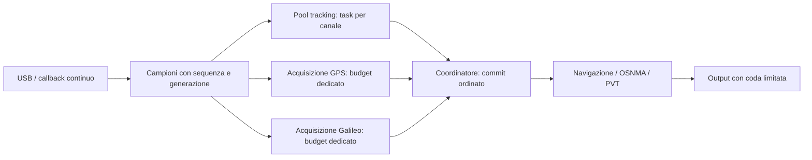

# NGene Classic — ottimizzazioni, profiling e distribuzione del carico

**Periodo:** 26-27 ottobre 2026. **Stato finale:** build Windows operativa senza
profiling aggiuntivo, 9/9 test superati, replay misti con 23 fix SiGe e 29 fix
HackRF. Nessun pool DSP concorrente attivato in questo intervento.

## 1. Risultato e significato delle misure

Il problema osservato non si riduce a un costo eccessivo del mixer HackRF.
L'acquisizione GNSS occupa gli slot del ricevitore anche durante i raffinamenti
lunghi; nel caso misto GPS/Galileo puo' ritardare la ricerca di altri GPS fino a
impedire il PVT durante la registrazione. La disponibilita' di tempo CPU medio
non garantisce che il lavoro venga assegnato nel modo utile al fix.

Con la stessa lista Galileo e gli stessi file RF, la pulizia Java/IFEN da sola
mantiene esattamente gli eventi GNSS precedenti. Introducendo una quota per
le ricerche Galileo, il replay misto passa da zero a 23 fix SiGe e 29 HackRF.
Il miglioramento dimostrato riguarda **disponibilita' del fix e scheduling**;
non e' una dimostrazione di maggiore accuratezza metrica o di uno speedup CPU.

La causa delle interruzioni USB live non e' stata riprodotta: la sonda non trova
il SiGe 16c0:072f. Il replay non esercita USB, firmware, driver o callback live.

## 2. Modifiche operative mantenute

### Catena essenziale senza Java e IFEN

Sono stati eliminati dal codice e dalla build:

- server TCP, protocollo e pacchetti della GUI Java, configurazione ricevuta
  dalla GUI e relativo ciclo di startup/stop;
- calcolo e invio di spettro, istogramma ed effemeridi destinati alla GUI;
- export dei messaggi di navigazione in formato IFEN e gestione dei relativi
  file, timestamp e split dei log;
- harness separato che riproduceva soltanto messaggi di navigazione IFEN e il
  suo template di configurazione;
- ricerca generatore di tutti i PRN Galileo e fallback implicito a tale ricerca.

Restano l'interfaccia ncurses predefinita e quella testuale (`-t`), i frontend
SiGe/HackRF, il replay RF, tracking, navigazione, PVT, RINEX/NMEA e i moduli di
autenticazione GNSS. L'opzione `--port` non esiste piu'. La configurazione e'
letta direttamente all'avvio, senza attendere un client esterno.

La ricerca automatica Galileo legge sempre
`otherData/Galileo_real_PRNs.txt`. La lista e' un dato mantenibile dall'utente,
non una verifica online dei satelliti attualmente operativi. Quando Galileo e'
abilitato, lista mancante, vuota o con PRN fuori dall'intervallo supportato
interrompe lo startup con un errore esplicito. Non parte una ricerca piu' ampia
senza avvertire l'operatore. Le configurazioni operative locali e i template
sono stati ripuliti dalle opzioni Java/IFEN rimosse.

### Quota di acquisizione tra costellazioni

`TChannelScheduler` mantiene un contatore delle ricerche Galileo attive.
Finche' il numero di canali GPS in tracking e' inferiore al numero configurato,
viene ammesso **un solo tentativo Galileo contemporaneo**. Un tentativo occupa
lo slot da assegnazione PRN fino a successo o fallimento, inclusi raffinamento
e conferma. Il contatore viene incrementato all'assegnazione e decrementato in
entrambi i percorsi di rilascio.

La ricerca Galileo rimane attiva. Quando non sono configurati canali GPS, il
limite aggiuntivo non si applica. Il limite totale storico di acquisizione,
variabile con il numero di canali tracciati, rimane in vigore. La quota non
equivale a una divisione del tempo CPU: e' una correzione minima dello scheduler
seriale, preparatoria a una distribuzione piu' completa del lavoro.

E' stata tolta la fissazione del main al processore logico 1; il sistema puo'
schedularlo liberamente. La gestione esistente del thread frontend resta
separata. Non si deduce una separazione fra core fisici dagli indici logici.

### Precisione e produzione

Questo intervento non cambia mixer, rappresentazione dei campioni, FFT,
correlatori, discriminatori, soglie di lock, carrier smoothing o algoritmi PVT.
Nessuna costante e' stata introdotta per spostare le coordinate verso una
posizione attesa. Le modalita' fast/precise sono un possibile intervento futuro.

Il profiling esteso e il runner sono conservati in `development/profiling/`,
esclusi dalla compilazione e installazione. Il main operativo conserva solo il
profiling storico, compilato fuori nella build normale. `build.cmd` imposta
esplicitamente `NGENE_RX_PROFILING=OFF`, anche dopo una build di misura.

## 3. Metodo di profiling

Ambiente: Windows x64, Intel Core i7-1355U, compilatore clang-cl del toolchain
Visual Studio e build nativa CMake/Ninja. L'assembly storico mantiene le opzioni
conservative gia' presenti; non e' stata applicata un'ottimizzazione globale
che potrebbe violarne il contratto sui registri.

Registrazioni locali:

| File | Dimensione | Durata nominale |
| --- | ---: | ---: |
| `recordings/native-ab.raw` | 794.615.808 byte | circa 48,55 s |
| `recordings/hackrf-l1-vga56-ci8.raw` | 1.145.831.424 byte | circa 70,01 s |

La configurazione mista usa 8 canali GPS, 8 Galileo e 1 EGNOS; il controllo GPS
usa 8/0/0, modificati soltanto nella copia della prova. In tutti i confronti del
27 ottobre la ricerca Galileo usa la medesima lista, anche nel vecchio binario.
Il vecchio binario trova l'opzione all-PRN assente e usa il proprio default
disabilitato: si confronta quindi la stessa politica della lista.

Ogni run copia binario, configurazione e dati in una cartella isolata
`build/profile-*/run-*`, poi salva stdout, stderr, exit code, hash del binario,
tempo wall e tempo CPU del processo. La strumentazione temporanea aggiunge:

- tempo di ingresso, comprendente lettura, attesa e conversione;
- lavoro dopo il riempimento del ring e tempo complessivo dei channel manager;
- tempi per stato e costellazione, massimo intervallo e avanzamento in campioni.

Il clock monotono misura tempo trascorso, incluse le deschedulazioni. Un massimo
di decine di millisecondi non prova un kernel altrettanto lungo in CPU. Il tempo
CPU del processo include startup e tutti i thread. I contatori di stato contano
anche chiamate che non avanzano il canale; il campo campioni permette di vedere
quanto lavoro temporale sia effettivamente avanzato. Non rappresenta il numero
di FFT o di bin. I sottostadi storici sono annidati: non vanno sommati agli
aggregati. Il profiling stesso aggiunge overhead.

## 4. Risultati controllati del 27 ottobre

Queste sono singole esecuzioni di confronto, non stime statistiche di speedup.

| Variante | File | Wall [s] | CPU processo [s] | Fix PVT | Perdite tracking riportate |
| --- | --- | ---: | ---: | ---: | ---: |
| Vecchio binario, lista limitata | SiGe | 10,26 | 9,17 | 0 | 0 |
| Pulizia Java/IFEN, senza quota | SiGe | 10,07 | 9,13 | 0 | 0 |
| Vecchio binario, lista limitata | HackRF | 17,66 | 16,55 | 0 | 0 |
| Pulizia Java/IFEN, senza quota | HackRF | 19,96 | 18,73 | 0 | 0 |
| Pulizia, controllo solo GPS | HackRF | 23,59 | 19,28 | 29 | 0 |
| Quota Galileo, misto, profiling esteso | HackRF | 21,39 | 20,34 | 29 | 0 |
| Quota Galileo, misto, profiling esteso | SiGe | 15,58 | 14,66 | 23 | 0 |
| **Produzione finale, profiling OFF, misto** | **HackRF** | **24,90** | **23,52** | **29** | **0** |
| **Produzione finale, profiling OFF, misto** | **SiGe** | **15,25** | **14,03** | **23** | **0** |

Il tempo piu' alto della run HackRF senza profiling rispetto a quella strumentata
evidenzia la variabilita' del sistema; non attribuire differenze fra singole run
al solo overhead dei contatori. Anche il lavoro cambia: ottenere piu' canali
in tracking e produrre PVT puo' aumentare il consumo CPU complessivo.

La produzione finale elabora entrambe le registrazioni piu' velocemente della
loro durata, ma questo margine medio non certifica la stabilita' live.

### Dove viene speso il tempo

Esempio HackRF misto dopo la sola pulizia, prima della quota:

| Stato | GPS [s] | Galileo [s] |
| --- | ---: | ---: |
| Ricerca grossolana | 0,517 | 8,150 |
| Raffinamento Doppler | 0,708 | 4,481 |
| Raffinamento codice | 0,089 | 0,569 |
| Tracking | 3,276 | nessun canale in quello stato |

Con la quota, sullo stesso file misto, la ricerca grossolana Galileo scende a
1,625 s e il raffinamento Doppler a 1,173 s; il tracking GPS sale a 6,691 s e
porta 29 fix. Nel controllo solo GPS il tracking pesa 12,039 s e produce ancora
29 fix: sono carichi satellitari diversi, non confronti di kernel equivalenti.

Il tempo per un millisecondo di timeline avanzata nel tracking GPS e' circa
9,47 us sul SiGe misto senza quota e 39,08 us sull'HackRF misto senza quota.
Con la quota HackRF e' circa 26,73 us. Queste differenze comprendono stato dei
loop, parser, logging, workload e scheduling: non isolano il costo della
precisione multibit. Per stabilirlo serve lo stesso input e lo stesso lavoro
attraverso due kernel controllati.

### Picchi e prime misure del 26 ottobre

Tre replay strumentati per frontend, con la precedente configurazione all-PRN,
hanno dato mediane CPU di 10,28 s SiGe e 18,72 s HackRF. Non vanno confrontate
direttamente con la quota finale: ordine PRN e workload sono differenti.
Su SiGe il massimo intervallo di elaborazione varia fra 8,0 e 66,6 ms nelle tre
run; sono picchi wall, non attribuzioni certe al DSP.

Nelle run con quota, i massimi di elaborazione escluso il riempimento sono
4,916 ms SiGe e 14,816 ms HackRF. Non basta questo confronto per sostenere una
riduzione ripetibile della latenza: carico e pianificazione OS variano.

## 5. Accuratezza del fix e verifiche di equivalenza

La sola pulizia mantiene **88 righe ordinate SiGe e 82 HackRF identiche** al
vecchio binario, rimossi timestamp host, percorsi di startup e il messaggio
relativo all'opzione IFEN eliminata. Queste configurazioni miste non producevano
PVT: il confronto verifica gli eventi registrati, non l'accuratezza dei fix.

Dopo la quota, la versione finale senza profiling mantiene **428 righe SiGe e
524 HackRF identiche** alla corrispondente versione strumentata, escluse le righe
di profiling e gli stessi metadati. Il confronto include epoche e coordinate
PVT stampate. Nessun CSV di profiling viene prodotto dalla build finale.

Il controllo HackRF solo GPS usa 5 satelliti nel primo fix; la prova mista con
quota ne usa 4. Le medie delle coordinate stampate sono:

| Configurazione HackRF | Latitudine [gradi] | Longitudine [gradi] | Altezza ellissoidica [m] |
| --- | ---: | ---: | ---: |
| Solo GPS, 29 fix | 44,24361876 | 7,39665100 | 947,929 |
| Mista con quota, 29 fix | 44,24358979 | 7,39668514 | 961,150 |

La differenza verticale di circa 13,22 m **non e' una misura di maggiore o minore
accuratezza**, perche' insieme di satelliti e storia delle osservazioni non sono
gli stessi e manca un riferimento d'antenna rilevato. E' comunque una differenza
da conservare come limite concreto: non si dichiara equivalenza delle osservabili
fra questi due workload. Le soglie non sono state allentate per ottenere i fix.

## 6. USB e ipotesi dell'analisi fornita

Il ricevitore ha gia' un thread USB; la parte DSP dei canali e' seriale.
Nel SiGe, quando il ring e' pieno il produttore attende. Continua a gestire gli
eventi, ma non puo' riciclare indefinitamente i trasferimenti completati senza
spazio. Il successivo timeout puo' riavviare lo stream e azzerare il ring USB.
La generazione del flusso risincronizza il decoder I/Q, ma non resetta tutta la
timeline del ring DSP, tracking e PVT. Questo resta un rischio concreto nel
codice, non una causa live confermata qui.

HackRF interrompe invece il ricevitore quando la sua coda va in overflow:
non continua indefinitamente dopo lo scarto di campioni. Con blocchi predefiniti:

| Buffer | Capacita' | Durata nominale a 16,3676 MB/s |
| --- | ---: | ---: |
| Trasferimenti SiGe, 128 blocchi | 1 MiB | 64,1 ms |
| Ring intermedio SiGe, 512 blocchi | 4 MiB | 256,3 ms |
| Coda applicativa HackRF | 1 MiB | 64,1 ms |

Le capacita' nominali non garantiscono assenza di perdite a monte. Aumentare una
coda assorbe burst, ma non rende sostenibile un consumer mediamente piu' lento.

La stima della soglia di conferma basata su carrier anziche' sui campioni
demodulati compare nel ramo storico non-wide; HackRF usa gia' un ramo distinto
`MeasureHackrfConfirmationNoise`. Quindi quel sospetto non va applicato
indistintamente a entrambi i frontend. Non e' stato corretto senza una verifica
statistica delle soglie. Anche lock checker e hard restart PVT restano invariati.
Il confronto con `CODE/Old NGene Code` e' stato fornito dall'utente e non ripetuto
in questo workspace.

## 7. Distribuzione del lavoro tra core: progetto successivo

La scelta proposta combina separazione per funzioni e task DSP per canale.

Punto di partenza da misurare: ingresso indipendente, pool tracking limitato,
due worker o due quote di lavoro per acquisizione GPS/Galileo, commit sul main.
Se una costellazione ha poco lavoro, la capacita' libera puo' essere usata
dall'altra. I numeri ottimali di worker non sono stati misurati qui: confrontare
1/2/4 worker e CPU, latenza, tempo al primo fix e continuita' live.

Due thread permanenti, uno per costellazione, garantiscono separazione delle
ricerche ma possono essere sbilanciati. Due tentativi GPS e due Galileo alternati
garantiscono una quota di opportunita', non del tempo CPU: il costo delle ricerche
non e' uguale. Serve interrompere il lavoro a passi limitati e conservare stato
ed epoca, senza aspettare il termine di un intero tentativo. La variante 2+2 e'
stata discussa ma non implementata o misurata, su indicazione di concludere prima
questo intervento.

Prerequisiti obbligatori:

| Dato o dipendenza | Intervento necessario |
| --- | --- |
| `ngeneXmmsBackup` globale nell'assembly | Backup privato per thread in tutti i moduli interessati o conversione a intrinsics con ABI completa |
| Carrier, mixer, subcarrier, codici e scratch FFT condivisi | Contesto DSP privato; copiare `TNGeneData` superficialmente non basta |
| Puntatori early/prompt/late del tracking | Eliminare l'aliasing verso `rx->codeArray` condiviso |
| Stato NCO e integrazioni | Un solo job in volo per canale, ordine temporale preservato |
| Scheduler PRN, non-coherent manager, warm start | Prenotazione e commit coerenti sul coordinatore |
| Parser, clock, OSNMA, PVT e buffer dei log | Separare elaborazione DSP e side effect condivisi |
| Ring e minimo offset fra canali | Rilasciare i campioni soltanto dopo tutti i lettori |

L'acquisizione deve possedere una finestra di campioni o un riferimento limitato
indipendente dall'avanzamento del tracking. Il candidato deve riportare
`streamGeneration`, primo campione, numero campioni e versione dello stato.
Un candidato vecchio richiede propagazione controllata o riconferma al tempo
corrente. Spostare soltanto la funzione su un thread lasciando il ring fermo
al minimo offset manterrebbe il blocco dell'intera catena.

Una discontinuita' deve invalidare job vecchi e lo stato temporale interessato.
Quando il gap non e' quantificabile, proseguire come se i campioni fossero
contigui non e' una gestione corretta della continuita' del PVT.

## 8. Fast e precise

La proposta fast riguarda la sinusoide **squadrata**, cioe' i segni di seno e
coseno, non il quadrato matematico della sinusoide. Puo' ridurre il costo del
mixer di ricerca. La scelta deve essere indipendente dal numero di worker.

Precise rimane il riferimento numerico. Fast, inizialmente solo acquisizione,
richiede confronto di sensibilita', falsi allarmi, segni Doppler, scaling delle
potenze e soglie di conferma. Non basta confrontare il tempo CPU: la squadratura
cambia il mixer e la sua risposta. Un eventuale tracking fast richiede anche
confronti delle osservabili e del PVT a parita' di satelliti. Nessuna di queste
approssimazioni e' attiva nella produzione finale.

## 9. Verifiche finali e materiali conservati

- Build Windows normale: **9/9 test superati** (frontend HackRF simulato, FFT,
  precisione I/Q, generatori DSP, SiGe, ring I/Q, errori e shutdown/restart USB,
  compatibilita' Windows).
- Replay finali: **23 fix SiGe / 29 HackRF**, exit code 0, nessuna perdita di
  tracking riportata e nessun file di profiling prodotto.
- Tre startup negativi: lista Galileo assente, vuota e PRN 51; tutti exit code 1.
- `--help` mostra testo/ncurses e non espone la porta Java.
- `git apply --check development/profiling/instrumentation.patch` superato.
- La verifica Linux di questo incremento e la prova live prolungata restano da
  eseguire; nessun risultato Windows/replay le sostituisce.

Il binario finale ha SHA-256
`7C54DB2A1E03C39D4227C53BE494453CB0283CE012AFD79E23D1F6DAA102480D`.
Il binario strumentato con quota ha SHA-256
`354DA93C42FF7F1528F72A40D08C6A9680CCD7C6472B37A2405708216293F83D`.

Le misure selezionate, profili di stato e hash sono conservati in
`development/profiling/results-20261027.json`. I log integrali locali sono nelle
cartelle `build/profile-*`; il file JSON ne conserva i riferimenti. Per ripetere
le misure usare [le istruzioni del laboratorio](development/profiling/README.md).
Per riprendere il lavoro in una sessione futura leggere [LOGBOOK.md](LOGBOOK.md).
